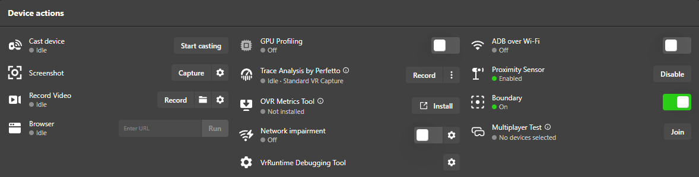
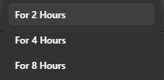

# ProxLock

[English](README.md) · [한국어](README.ko.md) · **日本語** · [中文](README.zh-CN.md)

Meta Quest の近接センサーを**再起動後も無効のまま維持**するアプリです。センサーをテープでふさいだのと同じ効果があります。

Meta Quest Developer Hub ではセンサーを 2/4/8 時間しか無効にできず、MQDH・SideQuest・`adb` のどの方法でも再起動すると元に戻ります。ProxLock はヘッドセット上で動く小さなアプリで、起動時と 5 分ごとに設定を再適用します。

## 作った理由

Quest Pro で Virtual Desktop を使っていると、ヘッドセットを外してかぶり直したり、少しスタンバイに入ってから戻ったりしたときに、**画面の揺れがひどくなりました。** 直すには Virtual Desktop を一度終了して起動し直すしかありませんでした。原因はヘッドセットのスリープだと考えられます。スリープから復帰すると、ストリーミングのフレームタイミングがずれてしまいます（詳しくは下記）。そこで最も直接的な解決策である**ヘッドセットをスリープさせないこと**、つまり近接センサーを無効にする方法を試すために、このアプリを作りました。

Meta Quest Developer Hub（MQDH）にもセンサーを無効にするボタンはありますが、問題を根本的には解決できません。



- **時間制限があります。** *Disable* を押しても **2 時間 / 4 時間 / 8 時間** から選ぶことしかできず、「ずっと無効」はありません。再起動しなくても、**時間が過ぎると設定が自動的に解除され**、ヘッドセットはまたスリープするようになります。

  

- **再起動するとリセットされます。** ヘッドセットを再起動するとセンサーは元どおり有効になっているので、毎回 PC につないで Disable を押し直す必要があります。SideQuest や `adb` コマンドでも同じです。

ProxLock はこの 2 つの制限をなくします。**起動するたびに自動でセンサーを無効にし、5 分ごとに再適用**するので、センサーをテープでふさいだのと同じように動作します。最初のインストール後は PC も必要ありません。

## 背景：スリープ後の Virtual Desktop の画面の揺れ

**症状：** Quest で Virtual Desktop（VD）を使っているとき、ヘッドセットを外してかぶり直したり、少しスタンバイに入ってから戻ったりすると、画面が揺れ続けます。VD を終了して起動し直すまで直りません。

**考えられる原因**（無線 PC ストリーミングの一般的な挙動で、すべての環境で測定したものではありません）：

1. **フレームタイミングのずれ**：ヘッドセットがスリープしている間、デコーダーと表示ループは止まりますが、PC 側のストリーマーは以前のタイミングのままです。復帰後にフレームが遅れたりまとめて届いたりし、リプロジェクション（タイムワープ）が補正し続けるため、画面が揺れて見えます。
2. **SSW/ASW がオンのまま残る**：復帰した瞬間にフレームが少し落ちると SSW（Synchronous SpaceWarp）がオンになり、そのまま戻らないことがあります。すると半分のフレームレートで補間された映像になり、物の輪郭が波打って見えます。
3. **トラッキング原点のリセット**：復帰時に Quest がガーディアンや原点を取り直すと、位置予測が一時的に乱れます。SpaceSync で合わせた Lighthouse トラッカーの位置がずれることもあります。

VD を再起動すると直るのは、ストリームのセッションが作り直され、すべてのタイミングが最初から合わせ直されるためです。

**ProxLock 以外の対処法：**

- VD を終了する代わりに、VD のメニューで **Disconnect** してから再接続します。たいていはこれで直り、ずっと速いです。
- VD の設定で **SSW** を *Disabled* か *Automatic* にします（*Always On* は避けてください）。
- ヘッドセットが 1 つの Wi-Fi 帯域（5GHz または 6GHz）だけにつながるよう固定し、復帰時に帯域が切り替わらないようにします。
- VD アプリと Streamer を最新版に保ちます。

ProxLock はこの根本原因をなくすために作りました。ヘッドセットがスリープしなければ、ストリームがスリープから復帰する必要もありません。

> **テスト状況：** ProxLock 自体の動作は確認済みです（再起動後もセンサーは無効のまま）。**これで VD の画面の揺れが実際に直るかは、まだテストしていません。** 結果はここに追記します。

## 対応デバイス

| デバイス | 状態 |
|---|---|
| Quest Pro | ✅ 動作確認済み（再起動を含む） |
| Quest 3 / 3S / 2 | 同じシステムコマンドを使うため動作する見込みですが未検証です。報告を歓迎します |

## インストール（Windows PC・ワンクリック）

1. **開発者モードをオン**：スマホの Meta Horizon アプリ → デバイス → ヘッドセット → ヘッドセットの設定 → 開発者モード
2. [Releases](../../releases) から `ProxLock-vX.Y.Z.zip` をダウンロードして展開します。
3. Quest を USB ケーブル（データ通信対応）で PC に接続します。
4. **`install.bat`** をダブルクリックします。ヘッドセット内で確認が出たら **「このコンピューターを常に許可」** にチェックして **「許可」** を押します。
5. インストーラーの案内が出たら、**ヘッドセットを一度かぶってください。** ProxLock の画面が表示されたら設定完了です。Android は一度起動したアプリしか起動時に自動実行しないためです。
6. 完了です。ケーブルを外してかまいません。

Quest のシステムアップデート後に動作しなくなった場合は、[Issue](../../issues) でお知らせください。

`adb` がない場合は、Google 公式サーバー（`dl.google.com`）から Android platform-tools を自動でダウンロードします。使用することで [Android SDK 利用規約](https://developer.android.com/studio/terms) に同意したものとみなされます。

## スマホからインストール（PC 不要・未検証）

1. 開発者モードをオンにします（上記 1）。
2. Android スマホに USB ADB アプリ（例：*Bugjaeger*）を入れ、`ProxLock.apk` をスマホにダウンロードします。
3. スマホと Quest を USB-C ケーブルで接続し、ヘッドセットで USB デバッグを許可してから、アプリで APK をインストールします。
4. **ヘッドセットで ProxLock を一度起動**します（ライブラリ → フィルター → *提供元不明*）。一度起動しないと起動時に自動で動作しません。

## 手動インストール（adb）

```
adb install -r ProxLock.apk
adb shell am start -n com.proxlock/.MainActivity
```

## 使い方

- 何もする必要はありません。起動時に自動で動作します。
- アプリの場所：ライブラリ → 右上のフィルター → **提供元不明** → ProxLock
- アプリ内の **Sensor ON** を押すと通常の動作に戻り、自動無効化も止まります。**Sensor OFF** で ProxLock が再び有効になります。

## アンインストール

`uninstall.bat` をダブルクリックすると、センサーを元に戻してアプリを削除します。または設定 → アプリから ProxLock を削除して再起動してください。

## ⚠️ 注意

- ヘッドセットを外しても**画面は点いたまま**です。電源ボタンでスリープしないとバッテリーが減ります。
- **レンズに直射日光を当てないでください。** 画面が点いているので特に注意が必要です。
- MQDH や SideQuest でセンサーを有効に戻しても、ProxLock が 5 分以内に再び無効にします。センサーを戻すときはアプリの **Sensor ON** ボタンを使ってください。
- 今後の Meta のアップデートでこの動作が変わった場合、ProxLock は効果がなくなるだけです。

## 仕組み / 安全性

- MQDH や Meta 公式ドキュメントと同じ `com.oculus.vrpowermanager.prox_close` コマンドを、起動時（`BOOT_COMPLETED`）と 5 分ごとに送ります。5 分ごとのアラームはスリープ中のデバイスを起こしません。
- 権限は `RECEIVE_BOOT_COMPLETED` のみです。インターネット・ストレージなどの権限はありません。約 10KB で、常駐サービスもありません。
- ソースは `app/` にあります。`build.sh` でビルドします（Android SDK + JDK、Gradle 不要）。

## 免責事項

Meta とは無関係で、Meta の承認も受けていません。「Meta Quest」は Meta Platforms, Inc. の商標です。自己責任でご利用ください。

## ライセンス

[MIT](LICENSE)
