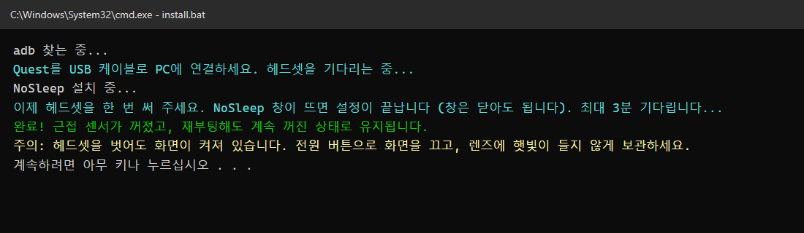
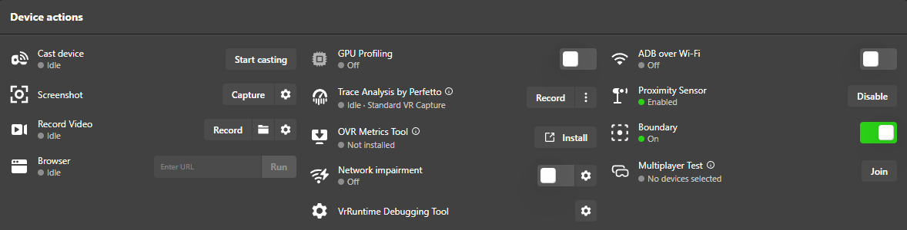
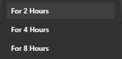

# NoSleep for Quest

[English](README.md) · **한국어** · [日本語](README.ja.md) · [中文](README.zh-CN.md)

Meta Quest의 근접 센서를 **재부팅해도 계속 꺼진 상태로 유지**해 주는 앱입니다. 센서를 테이프로 막은 것과 같은 효과로, 헤드셋을 벗어도 대기모드로 넘어가지 않습니다.

## 지원 기기

| 기기 | 상태 |
|---|---|
| Quest Pro | ✅ 테스트 완료 (재부팅 포함) |
| Quest 2 | ✅ 테스트 완료 (재부팅 포함) |
| Quest 3 / 3S | 같은 시스템 명령을 쓰므로 작동할 것으로 예상되지만 아직 미검증입니다. 테스트 결과를 알려 주세요 |

## 설치

아래 두 가지 방법 중 **하나**를 고르세요.

| | |
|---|---|
| 💻 **A. Windows PC** | [**NoSleep-for-Quest-v1.0.1.zip**](https://github.com/Leenamgi20/NoSleep-for-Quest/releases/latest/download/NoSleep-for-Quest-v1.0.1.zip) |
| 📱 **B. 안드로이드 폰** (PC 없이) | [**NoSleep-Installer.apk**](https://github.com/Leenamgi20/NoSleep-for-Quest/releases/latest/download/NoSleep-Installer.apk) |

### A. Windows PC (원클릭)

1. **개발자 모드 켜기**: 폰의 Meta Horizon 앱 → 기기 → 내 헤드셋 → 헤드셋 설정 → 개발자 모드
2. 위 표에서 **NoSleep-for-Quest-v1.0.1.zip**을 받아 압축을 풉니다.
3. Quest를 USB 케이블(데이터 전송이 되는 것)로 PC에 연결합니다.
4. **`install.bat`**을 더블클릭합니다.
5. 헤드셋을 쓰고 **"USB 디버깅을 허용하시겠습니까?"** 알림을 엽니다 (안 보이면 알림창을 여세요). **"이 컴퓨터에서 항상 허용"**을 체크하고 **허용**을 누릅니다.
6. NoSleep 창이 뜰 때까지 헤드셋을 쓰고 있어 주세요. 설치 프로그램에 **완료!**가 나오면 케이블을 빼도 됩니다.



### B. 안드로이드 폰 (PC 없이)

1. **개발자 모드**를 켭니다 (위와 같음).
2. 폰에서 위 표의 **NoSleep-Installer.apk**를 받아서 엽니다.
   - "출처를 알 수 없는 앱" 경고가 나오면 브라우저나 파일 앱에 설치 권한을 허용하세요.
   - Google Play 프로텍트가 알 수 없는 앱이라고 하면 **세부정보 더보기 → 무시하고 설치**를 누르세요.
3. **NoSleep Installer**를 열고 언어를 고릅니다.
4. 폰과 Quest를 USB 케이블(C to C 또는 OTG 젠더)로 연결합니다.
5. **NoSleep 설치**를 누릅니다. 폰에서 USB 기기 접근을 허용할지 물으면 **확인**을 누릅니다.
6. 헤드셋을 쓰고 USB 디버깅을 허용합니다 (PC 설치 5번과 같음).
7. NoSleep 창이 뜰 때까지 헤드셋을 쓰고 있어 주세요. 폰에 **완료!**가 나오면 케이블을 빼도 됩니다.

아이폰으로는 설치할 수 없습니다 (iOS는 앱이 USB 기기를 제어하지 못하게 막습니다). 아이폰 사용자는 PC 설치를 이용해 주세요.

## 사용법

- 따로 할 일은 없습니다. 부팅할 때마다 자동으로 작동합니다.
- 앱 위치: 라이브러리 → 오른쪽 위 필터 → **알 수 없는 출처** → NoSleep
- **센서 켜기** 버튼: 센서가 원래대로 작동하고 자동으로 끄는 것도 멈춥니다. **센서 끄기**: NoSleep이 다시 작동합니다.

## ⚠️ 주의

- 헤드셋을 벗어도 **화면이 켜진 채로 있습니다.** 전원 버튼으로 화면을 끄지 않으면 배터리가 닳습니다.
- **렌즈에 햇빛이 들지 않게 보관하세요.** 화면이 켜져 있으니 더 주의해야 합니다.
- 센서를 다시 켜려면 앱의 **센서 켜기** 버튼을 쓰세요. MQDH나 SideQuest로 켜면 NoSleep이 5분 안에 다시 끕니다.

## 삭제

`uninstall.bat`을 더블클릭하면 센서를 원래대로 돌리고 앱을 삭제합니다. 또는 헤드셋의 설정 → 앱에서 NoSleep을 삭제한 뒤 재부팅해도 됩니다.

## 문제가 생기면

Quest 시스템 업데이트 후 작동하지 않는 등 문제가 생기면 [Issue](../../issues)로 알려 주세요.

---

<br>

# 참고 자료

*배경 설명과 기술적인 내용입니다. NoSleep을 쓰는 데 필요한 내용은 아닙니다.*

## 다른 설치 방법

**수동 설치 (adb)**

```
adb install -r NoSleep.apk
adb shell am start -n com.proxlock/.MainActivity
```
그다음 헤드셋을 써서 앱이 한 번 열리게 해 주세요.

**adb 관련:** PC에 `adb`가 없으면 `install.bat`이 Google 공식 서버(`dl.google.com`)에서 Android platform-tools를 자동으로 받습니다. 사용 시 [Android SDK 약관](https://developer.android.com/studio/terms)에 동의하는 것으로 간주됩니다.

## 만든 이유

Quest Pro로 Virtual Desktop을 쓰다가 헤드셋을 벗었다 다시 쓰거나 잠시 대기모드에 들어갔다 돌아오면 **화면 일렁임이 심해졌습니다.** Virtual Desktop을 껐다 켜야만 해결됐습니다. 헤드셋이 잠드는 것이 원인으로 보여서(아래 참고), 가장 직접적인 해결책인 **헤드셋이 아예 잠들지 않게 하기**, 즉 근접 센서를 끄는 방법을 시도하려고 이 앱을 만들었습니다.

Meta Quest Developer Hub(MQDH)에도 센서를 끄는 버튼은 있지만, 문제를 제대로 해결해 주지는 못합니다.



- **시간 제한이 있습니다.** *Disable*을 누르면 **2시간 / 4시간 / 8시간** 중에서만 고를 수 있고, "계속 끄기"는 없습니다. 재부팅하지 않아도 **시간이 지나면 설정이 저절로 풀려** 헤드셋이 다시 잠들기 시작합니다.

  

- **재부팅하면 초기화됩니다.** 헤드셋을 다시 켜면 센서가 원래대로 켜져 있어서, 매번 PC에 연결해 Disable을 다시 눌러야 합니다. SideQuest나 `adb` 명령도 마찬가지입니다.

NoSleep은 이 두 가지 제한을 모두 없앱니다. 부팅할 때마다 자동으로 센서를 끄고 5분마다 다시 적용하므로, 처음 설치한 뒤로는 PC가 필요 없습니다.

## 대기모드 후 Virtual Desktop 화면 일렁임

**증상:** Quest에서 Virtual Desktop(VD)을 쓸 때, 헤드셋을 벗었다 다시 쓰거나 잠시 대기모드에 들어갔다 돌아오면 VD를 껐다 켤 때까지 화면이 계속 일렁입니다.

**추정 원인** (무선 PC 스트리밍의 일반적인 동작이며, 모든 환경에서 측정한 결과는 아닙니다):

1. **프레임 타이밍이 어긋남**: 헤드셋이 잠든 동안 디코더와 디스플레이 루프는 멈추지만, PC 쪽 스트리머는 이전 타이밍을 그대로 씁니다. 깨어난 뒤 프레임이 늦게 오거나 몰려서 오고, 재투영(타임워프)이 계속 보정하면서 화면이 일렁여 보입니다.
2. **SSW/ASW가 켜진 채로 남음**: 깨어나는 순간 프레임이 잠깐 떨어지면 SSW(Synchronous SpaceWarp)가 켜지는데, 그대로 꺼지지 않는 경우가 있습니다. 그러면 반쪽 프레임레이트로 보간한 화면이 나와 물체 가장자리가 물결칩니다.
3. **트래킹 원점이 바뀜**: 깨어나면서 Quest가 가디언이나 원점을 다시 잡으면 위치 예측이 잠시 흔들립니다. SpaceSync로 보정한 Lighthouse 트래커 위치가 어긋날 수도 있습니다.

VD를 껐다 켜면 해결되는 이유는, 스트림 세션이 새로 만들어지면서 모든 타이밍이 처음부터 다시 맞춰지기 때문입니다.

**NoSleep 말고 할 수 있는 방법:** VD를 완전히 끄는 대신 VD 메뉴에서 **Disconnect** 후 다시 연결하기, VD 설정에서 **SSW**를 *Disabled* 또는 *Automatic*으로 두기, 헤드셋을 Wi-Fi 대역 하나(5GHz 또는 6GHz)에만 고정하기, VD 앱과 Streamer를 최신 버전으로 유지하기.

> **테스트 결과 (Quest Pro):** 헤드셋을 벗어도 대기모드로 넘어가지 않으므로 일렁임이 생기지 않았습니다. **하지만 전원 버튼을 눌러 대기모드로 넘어갔다 돌아오면 같은 일렁임이 다시 생깁니다.** 즉 NoSleep은 평소 사용할 때 문제를 피하게 해 주지만, VD 문제 자체의 근본적인 해결책은 아닙니다. 전원 버튼으로 대기모드에 들어갔다 돌아온 뒤에는 VD에서 **Disconnect → 다시 연결**하세요.

## 작동 원리 / 안전성

- MQDH와 Meta 공식 문서에서 쓰는 것과 같은 `com.oculus.vrpowermanager.prox_close` 명령을 부팅할 때(`BOOT_COMPLETED`)와 5분마다 보냅니다. 5분 알람은 잠든 기기를 깨우지 않는 방식입니다.
- 안드로이드는 한 번 열린 적이 있는 앱에만 부팅 신호를 보내 줍니다. 그래서 설치 프로그램이 헤드셋을 한 번 써 달라고 안내합니다.
- 권한은 `RECEIVE_BOOT_COMPLETED` 하나뿐입니다. 인터넷·저장소 등 다른 권한은 없습니다. 용량은 약 10KB이고, 백그라운드에 상주하지 않습니다.
- 소스는 `app/` 폴더에 있습니다. `build.sh`로 빌드합니다 (Android SDK + JDK, Gradle 불필요).
- 폰 설치 앱(`android-installer/`)은 [AdbLib](https://github.com/cgutman/AdbLib)(BSD-3-Clause, 라이선스 포함)로 USB를 통해 ADB 통신을 합니다. 인터넷 권한이 없고, 연결된 헤드셋에 NoSleep을 설치·실행하거나 삭제하는 일만 합니다. NoSleep.apk가 앱 안에 들어 있습니다.

## 면책

Meta와 관련이 없으며 Meta의 승인을 받지 않았습니다. "Meta Quest"는 Meta Platforms, Inc.의 상표입니다. 사용에 따른 책임은 사용자에게 있습니다.

## 라이선스

[MIT](LICENSE)
