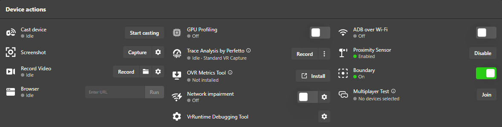

# ProxLock

**English** · [한국어](README.ko.md) · [日本語](README.ja.md) · [中文](README.zh-CN.md)

Keeps the Meta Quest proximity sensor **disabled permanently, even after reboots**, just like covering the sensor with tape. The headset no longer goes to sleep when you take it off.

## Supported devices

| Device | Status |
|---|---|
| Quest Pro | ✅ Tested (incl. reboot) |
| Quest 2 | ✅ Tested (incl. reboot) |
| Quest 3 / 3S | Should work (same system command), not yet tested. Reports welcome |

## Install (Windows PC, one click)

1. Turn on **Developer Mode**: Meta Horizon phone app → Devices → your headset → Headset settings → Developer Mode.
2. Download `ProxLock-vX.Y.Z.zip` from [Releases](../../releases) and unzip it.
3. Connect the Quest to the PC with a USB cable (data-capable).
4. Double-click **`install.bat`**. If asked inside the headset, tick **"Always allow from this computer"** and press **Allow**.
5. When the installer says so, **put on the headset once**. Setup is complete when the ProxLock window appears.
6. Done. You can unplug the cable.

No PC? See [Other install methods](#other-install-methods).

## Usage

- Nothing to do: it runs automatically at every boot.
- To find the app: Library → top-right filter → **Unknown Sources** → ProxLock.
- **Sensor ON** button: sensor works normally again and auto-disabling stops. **Sensor OFF**: ProxLock is active again.

## ⚠️ Important

- The screen **stays on** when you take the headset off. Press the power button to sleep it, or the battery will drain.
- **Never leave the lenses facing sunlight.** With the display on, this matters even more.
- To turn the sensor back on, use the in-app **Sensor ON** button. If you use MQDH/SideQuest instead, ProxLock turns it off again within 5 minutes.

## Uninstall

Double-click `uninstall.bat` (restores the sensor and removes the app), or uninstall ProxLock from Settings → Apps and reboot.

## Problems?

If it stops working (e.g. after a Quest system update), please open an [Issue](../../issues).

---

<br>

# Reference

*Background and technical details. You don't need any of this to use ProxLock.*

## Other install methods

**Android phone (no PC, untested)**

1. Enable Developer Mode (install step 1).
2. Install a USB ADB app on the phone (e.g. *Bugjaeger*) and download `ProxLock.apk` to the phone.
3. Connect phone ↔ Quest with a USB-C cable, allow USB debugging in the headset, and install the APK from the app.
4. **Open ProxLock once in the headset** (Library → filter → *Unknown Sources*). This is required for it to run at boot.

**Manual (adb)**

```
adb install -r ProxLock.apk
adb shell am start -n com.proxlock/.MainActivity
```
Then put on the headset so the app opens once.

**About adb:** if `adb` isn't installed, `install.bat` automatically downloads Google's official Android platform-tools from `dl.google.com` (by using it you accept the [Android SDK terms](https://developer.android.com/studio/terms)).

## Why I made this

When I used Virtual Desktop on my Quest Pro, taking the headset off or letting it go into standby made the image start **wobbling badly when I came back**. The only fix was to quit and restart Virtual Desktop. The likely cause is the headset going to sleep (see below), so I made this to try the most direct fix: **never let the headset sleep**, which means disabling the proximity sensor.

Meta Quest Developer Hub (MQDH) does have a switch for this, but it doesn't really solve the problem:



- **It is time-limited.** Pressing *Disable* only offers **2, 4 or 8 hours**. There is no "forever" option. Even without a reboot, the setting **turns itself off when the time runs out** and the headset starts sleeping again.

  

- **It resets on every reboot.** After the headset restarts, the sensor is back on, so you have to plug into the PC and press Disable again each time. The same is true for SideQuest and the `adb` command.

ProxLock removes both limits: it turns the sensor off automatically at every boot and re-applies it every 5 minutes. No PC is needed after the first install.

## Virtual Desktop wobble after sleep

**Symptom:** using Virtual Desktop (VD) on Quest, after taking the headset off and putting it back on, or after a short standby, the image keeps wobbling/juddering until VD is restarted.

**Likely causes** (general behavior of wireless PC streaming, not measured on every setup):

1. **Frame pacing desync**: while the headset sleeps, its decoder and display loop stop, but the PC streamer keeps its old timing. After waking, frames arrive late or in bursts, and reprojection (timewarp) keeps correcting, which looks like wobble.
2. **SSW/ASW gets stuck on**: a brief frame drop on wake can switch on Synchronous SpaceWarp, and it sometimes stays on, giving half-rate interpolated frames with rippling edges.
3. **Tracking origin reset**: the Quest may re-center the guardian/origin on wake, briefly disturbing pose prediction (and possibly shifting SpaceSync-calibrated Lighthouse trackers).

Restarting VD fixes it because a fresh stream session re-syncs everything from scratch.

**Workarounds besides ProxLock:** use **Disconnect** in the VD menu and reconnect instead of restarting VD; set **SSW** to *Disabled* or *Automatic*; pin the headset to one Wi-Fi band (5 GHz or 6 GHz); keep VD and the Streamer up to date.

> **Test result (Quest Pro):** taking the headset off no longer causes the wobble, because the headset no longer goes to sleep. **But if you press the power button to put it into standby, the same wobble comes back after waking.** So ProxLock avoids the problem in everyday use, but it is not a fix for the underlying VD issue. After a power-button standby, use **Disconnect → reconnect** in VD.

## How it works / safety

- Sends `com.oculus.vrpowermanager.prox_close` (the same command MQDH and Meta's docs use) on `BOOT_COMPLETED` and via an inexact 5-minute alarm that does not wake the device.
- Android only delivers the boot signal to apps that have been opened once, which is why the installer asks you to put on the headset.
- Only permission: `RECEIVE_BOOT_COMPLETED`. No internet, storage, or other permissions. About 10 KB, no background service.
- Source is in `app/`. Build with `build.sh` (Android SDK + JDK, no Gradle).

## Disclaimer

Not affiliated with or endorsed by Meta. "Meta Quest" is a trademark of Meta Platforms, Inc. Use at your own risk.

## License

[MIT](LICENSE)
