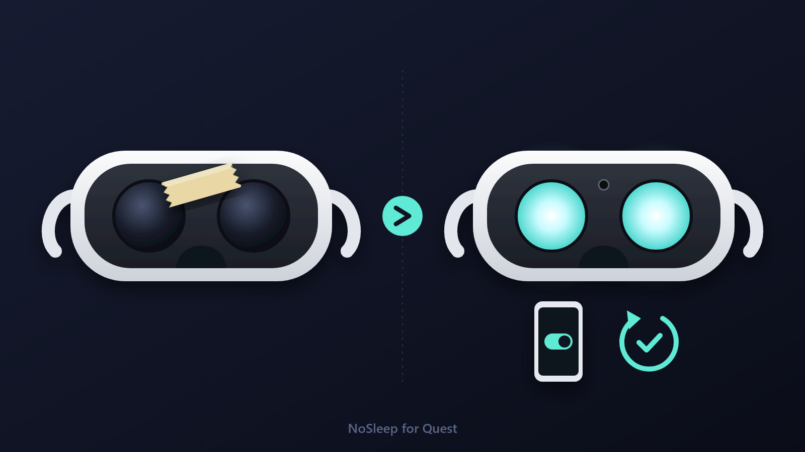
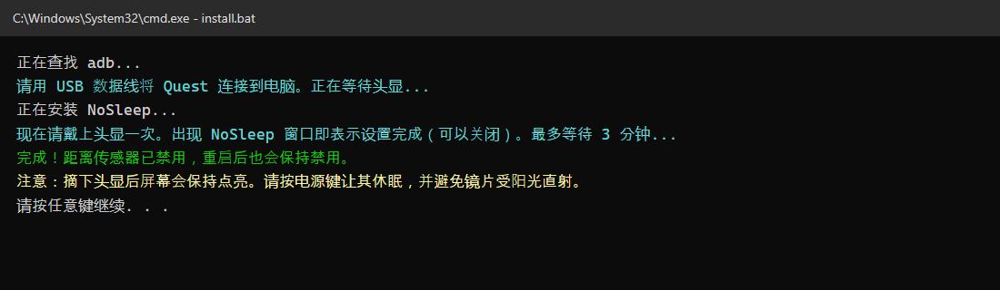
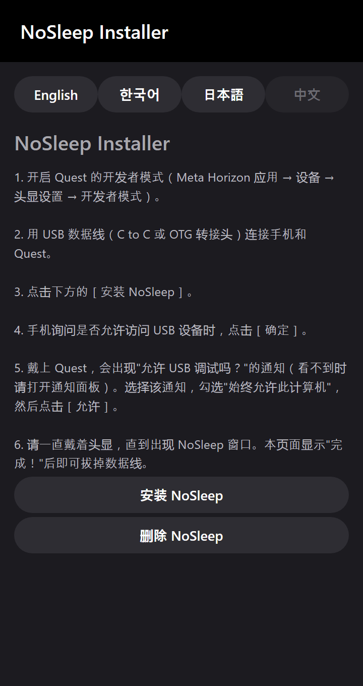
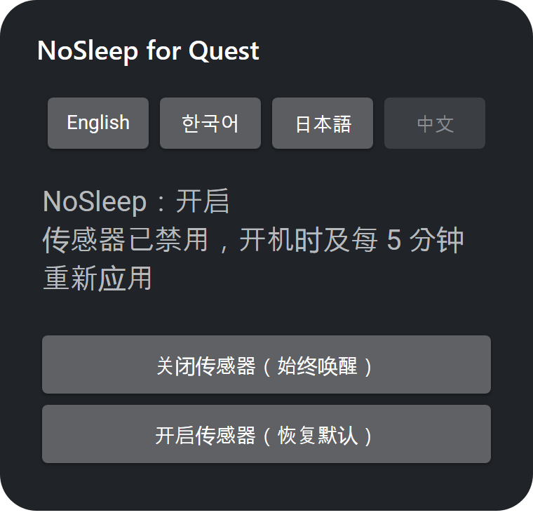
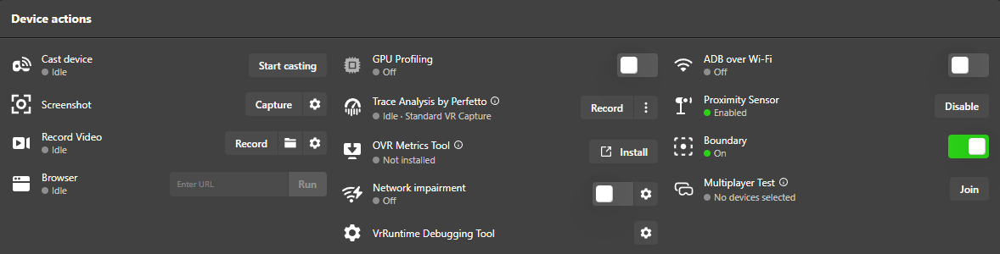

# NoSleep for Quest



[English](README.md) · [한국어](README.ko.md) · [日本語](README.ja.md) · **中文**

让 Meta Quest 的距离传感器**永久保持禁用，重启后也不会恢复**，效果和用胶带遮住传感器一样：摘下头显后也不会进入休眠。

## 支持的设备

| 设备 | 状态 |
|---|---|
| Quest Pro | ✅ 已测试（包括重启） |
| Quest 2 | ✅ 已测试（包括重启） |
| Quest 3 / 3S | 使用相同的系统命令，应该可以运行，但尚未测试，欢迎反馈 |

## 安装

请从下面两种方法中**任选一种**。

| | |
|---|---|
| 💻 **A. Windows 电脑** | [**NoSleep-for-Quest-v1.0.1.zip**](https://github.com/Leenamgi20/NoSleep-for-Quest/releases/latest/download/NoSleep-for-Quest-v1.0.1.zip) |
| 📱 **B. 安卓手机**（无需电脑） | [**NoSleep-Installer.apk**](https://github.com/Leenamgi20/NoSleep-for-Quest/releases/latest/download/NoSleep-Installer.apk) |

### A. Windows 电脑（一键安装）

1. **开启开发者模式**：手机上的 Meta Horizon 应用 → 设备 → 你的头显 → 头显设置 → 开发者模式
2. 从上表下载 **NoSleep-for-Quest-v1.0.1.zip** 并解压。
3. 用 USB 数据线（需支持数据传输）把 Quest 连接到电脑。
4. 双击 **`install.bat`**。
5. 戴上头显，打开 **"允许 USB 调试吗？"** 通知（看不到时请打开通知面板），勾选 **"始终允许此计算机"** 并点击 **允许**。
6. 请一直戴着头显，直到出现 NoSleep 窗口。安装程序显示 **完成！** 后即可拔掉数据线。



### B. 安卓手机（无需电脑）

1. 开启 **开发者模式**（同上）。
2. 在手机上从上表下载并打开 **NoSleep-Installer.apk**。
   - 如果手机提示"未知来源应用"，请允许浏览器或文件应用安装。
   - 如果 Google Play 保护机制提示是未知应用，请点击 **更多详情 → 仍然安装**。
3. 打开 **NoSleep Installer** 并选择语言。
4. 用 USB 数据线（C to C 或 OTG 转接头）连接手机和 Quest。
5. 点击 **安装 NoSleep**。手机询问是否允许访问 USB 设备时，点击 **确定**。
6. 戴上头显并允许 USB 调试（与电脑安装第 5 步相同）。
7. 请一直戴着头显，直到出现 NoSleep 窗口。手机显示 **完成！** 后即可拔掉数据线。



iPhone 无法安装（iOS 不允许应用控制 USB 设备）。iPhone 用户请使用电脑安装。

## 使用方法

- 无需任何操作，每次开机都会自动运行。
- 应用位置：应用库 → 右上角筛选 → **未知来源** → NoSleep
- **开启传感器** 按钮：传感器恢复正常，并停止自动禁用。**关闭传感器**：重新启用 NoSleep。



## ⚠️ 注意事项

- 摘下头显后**屏幕会保持点亮**。请按电源键让它休眠，否则会耗电。
- **切勿让镜片受到阳光直射**。屏幕点亮时更要注意。
- 要恢复传感器，请使用应用内的 **开启传感器** 按钮。如果用 MQDH 或 SideQuest 开启，NoSleep 会在 5 分钟内再次将其关闭。

## 卸载

双击 `uninstall.bat`，会恢复传感器并删除应用。也可以在设置 → 应用中卸载 NoSleep，然后重启。

## 遇到问题？

如果出现问题（例如 Quest 系统更新后不再起作用），请提交 [Issue](../../issues)。

---

<br>

# 参考资料

*背景说明和技术细节。使用 NoSleep 不需要了解这些内容。*

## 其他安装方法

**手动安装（adb）**

```
adb install -r NoSleep.apk
adb shell am start -n com.proxlock/.MainActivity
```
然后戴上头显，让应用打开一次。

**关于 adb：** 如果电脑上没有 `adb`，`install.bat` 会自动从 Google 官方服务器（`dl.google.com`）下载 Android platform-tools。使用即表示你同意 [Android SDK 条款](https://developer.android.com/studio/terms)。

## 开发原因

每次短暂摘下 Quest，它都会进入待机，重新戴上时还得等它唤醒并重新连接。解决办法很简单：**不让头显休眠**，也就是禁用距离传感器。很多人会用胶带遮住传感器来做到这一点，但我想在不用胶带的情况下达到同样的效果，所以开发了这个应用。

Meta Quest Developer Hub（MQDH）里虽然有禁用传感器的开关，但并不能真正解决问题：



- **有时间限制。** 点击 *Disable* 后只能选择 **2 小时 / 4 小时 / 8 小时**，没有"永久禁用"选项。即使不重启，**时间一到设置也会自动失效**，头显又会开始休眠。

  

- **重启后会重置。** 头显重启后传感器会恢复开启，每次都得连上电脑重新点 Disable。SideQuest 和 `adb` 命令也一样。

NoSleep 解决了这两个限制：它会在每次开机时自动禁用传感器，并每 5 分钟重新应用一次。首次安装之后就不再需要电脑。

## 工作原理 / 安全性

- 在开机时（`BOOT_COMPLETED`）以及每 5 分钟发送一次 `com.oculus.vrpowermanager.prox_close`，与 MQDH 和 Meta 官方文档使用的命令相同。5 分钟的闹钟不会唤醒休眠中的设备。
- Android 只会把开机通知发给至少打开过一次的应用，所以安装程序会提示你戴上头显一次。
- 只申请了 `RECEIVE_BOOT_COMPLETED` 一个权限，没有网络、存储等其他权限。大小约 10KB，没有常驻后台服务。
- 源代码在 `app/` 目录中，用 `build.sh` 构建（Android SDK + JDK，无需 Gradle）。
- 手机安装程序（`android-installer/`）使用 [AdbLib](https://github.com/cgutman/AdbLib)（BSD-3-Clause，已附许可证）通过 USB 进行 ADB 通信。它没有网络权限，只会在连接的头显上安装、启动或删除 NoSleep。NoSleep.apk 内置在应用中。

## 免责声明

本项目与 Meta 无关，也未获得 Meta 的认可。"Meta Quest" 是 Meta Platforms, Inc. 的商标。使用风险自负。

## 许可证

[MIT](LICENSE)
